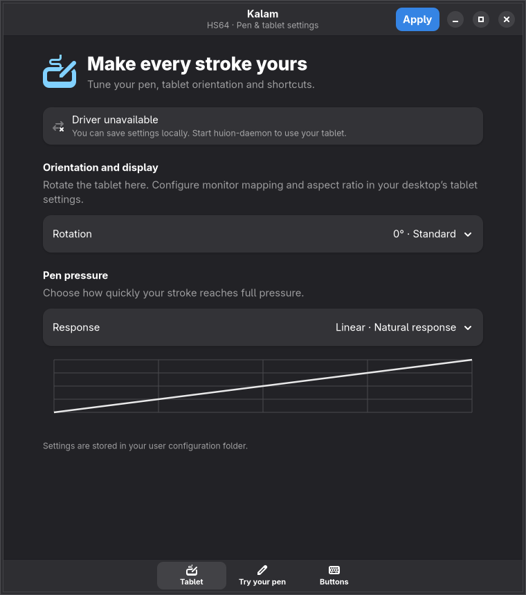

# Kalam V1.0.0

**Kalam is a reverse engineering project made by nirusaki.**

[](https://github.com/Nirusaki-Malaal/HuionHS64-Wayland/actions/workflows/ci.yml)

A Rust userspace driver and native GTK4/Libadwaita settings app for the connected
Huion HS64 (`256c:006f`). The daemon reads HID reports and creates a Linux tablet
and shortcut device through `/dev/uinput`; it does not use X11 or XTest injection.



[Large pen workspace](docs/images/pen-workspace.png) ·
[Physical button layout](docs/images/buttons.png)

## Current behavior

- Standard-mode pen coordinates, pressure, hover, tip and two barrel buttons.
- Pressure response curves, tablet active-area configuration and four rotations.
- Four configurable express buttons with shared-modifier handling and releases.
- Native settings interface with action presets, editable custom shortcuts,
  actual stylus pressure/stroke testing, and live driver status.
- One daemon per user session; exclusive physical input ownership prevents
  kernel fallback events from competing with virtual input.
- SIGTERM/disconnect cleanup releases virtual devices and physical grabs.

This implementation targets the observed HS64 standard mode (`0x0a` pen,
`0x03` keyboard). Vendor `0x08` reports are preserved but not interpreted or
used to switch firmware modes. Other Huion models are not supported. Display
selection and aspect-ratio mapping belong to the compositor; tilt is not
advertised by this HS64. See [documentation.md](documentation.md) for
implementation details and limitations.

## Easy installation

Download the Linux x86_64 build from [Kalam V1.0.0](https://github.com/Nirusaki-Malaal/HuionHS64-Wayland/releases/tag/v1.0.0).
Build files are attached to the release, and CI also uploads them as workflow
artifacts. Generated binaries and archives stay out of the Git source tree.

The prebuilt release is built on **Ubuntu 24.04 x86_64**, with glibc 2.39,
GTK4 4.14 and Libadwaita 1.5. Use Ubuntu 24.04 or newer, or a compatible current
Linux distribution. On older distributions, build from source instead. This is
a dynamically linked native GTK app, not a self-contained AppImage.

Install runtime dependencies on Ubuntu:

```sh
sudo apt-get update
sudo apt-get install -y libgtk-4-1 libadwaita-1-0 python3
```

Download, verify and install:

```sh
curl -fLO https://github.com/Nirusaki-Malaal/HuionHS64-Wayland/releases/download/v1.0.0/kalam-1.0.0-linux-x86_64.tar.gz
curl -fLO https://github.com/Nirusaki-Malaal/HuionHS64-Wayland/releases/download/v1.0.0/SHA256SUMS
sha256sum --check SHA256SUMS
tar -xzf kalam-1.0.0-linux-x86_64.tar.gz
cd kalam-1.0.0-linux-x86_64
./install.sh
huion-gui
```

Run the installer as your normal desktop user. It asks for sudo only to copy
system files, load uinput and refresh udev, then starts/restarts your user
service. It also configures uinput to load on boot. To enable service autostart,
use `./install.sh --enable`. To copy files without starting a service, use
`./install.sh --no-start`.

Uninstall from the extracted archive or source checkout:

```sh
./uninstall.sh
```

Uninstall stops/disables the user service and removes installed Kalam files.
Your personal tablet settings are preserved. It does not edit keyd settings.
Keep the extracted folder if you want to use its uninstall script later.

## Build from source

Requires Linux, a desktop session bus, Rust **1.89 or newer** (file locking),
Python **3.11 or newer**, GTK4, Libadwaita **1.2 or newer**, pkg-config, and uinput.
Install development dependencies on your distribution first:

```sh
# Ubuntu/Debian
sudo apt-get install -y build-essential libgtk-4-dev libadwaita-1-dev pkg-config python3
# Arch Linux
sudo pacman -S --needed base-devel rust gtk4 libadwaita python
```

Then install from the checkout with one command:

```sh
./install.sh
```

The source installer builds with `cargo build --release --locked --workspace`
as your normal user before escalating for system installation. If already
built, use `./install.sh --no-build`. For an isolated packaging test, use
`./install.sh --no-build --destdir /tmp/kalam-stage`; staging never changes
udev, modules, your service or the live system.

The service needs access to the physical tablet's hidraw **and evdev** nodes,
and `/dev/uinput`. Rules grant these through the active seat and `input` group.
Group changes require a new login. If another tablet driver owns the device,
stop it before starting Kalam.

### If you use keyd or another input remapper

A wildcard keyd configuration can grab the physical HS64 keyboard and re-inject
its factory shortcuts. Libinput ignore rules do not block that path. Exclude
this tablet's IDs in the matching keyd configuration's `[ids]` section:

```ini
[ids]
*
-256c:006f
```

Then run `sudo keyd reload`. Back up your configuration before editing. Both
physical and replacement devices use these IDs; all other keyboard mappings
can remain in place. The daemon refuses to inject tablet input when it cannot
obtain exclusive ownership. Look for `Cannot exclusively grab` in its log.

## Configure and verify

Open `huion-gui`. Use **Tablet** for pressure/orientation and **Buttons** to
choose named actions beside the physical layout diagram, then click **Apply**.
With the cable at the top, buttons1/2 are the left pair and3/4 the right pair.

Open the separate **Try your pen** page for a larger expanding workspace. Its
rotation control turns the test sheet between landscape and portrait while
keeping strokes under the cursor; it does not change system tablet mapping.
Draw in **Try your pen**: its meter and stroke width use actual
stylus pressure delivered by the compositor. Mouse motion does not simulate
pressure. Also test in your drawing app with a brush that uses pen pressure.

Settings live in `$XDG_CONFIG_HOME/huion-wayland/config.toml`, falling back to
`~/.config/huion-wayland/config.toml`. Offline saves take effect on daemon
restart. Live saves apply through D-Bus and are persisted atomically.

```sh
journalctl --user -u huion-wayland.service -f
python tools/capture_tablet.py --seconds 30 --output /tmp/hs64.json
```

The descriptor declares pressure max 4095, but live standard-mode reports exceed
that value. Pressure therefore passes through in the nominal 0-8191 range;
scaling from the descriptor would clip firm strokes. Coordinates are normalized
from native 32000 × 20400 into the existing configuration range 40000 × 25000.

## Tests

```sh
cargo test --workspace
cargo clippy --workspace --all-targets -- -D warnings
cargo fmt --all -- --check
# Requires uinput/evdev access, with the HS64 excluded from remappers:
cargo test -p huion-daemon -- --include-ignored
# Requires the installed running service (roundtrips existing settings):
python tests/session_e2e.py
# Briefly stops/restarts the service and checks ownership/fallback:
python tests/lifecycle_e2e.py
```

Kernel tests grab their temporary devices before sending test events. They fail
if a remapper owns those devices. Hardware interaction and application pressure
response are separate from synthetic kernel tests. The CI workflow checks code
and packaging; hardware behavior requires the local live-session checks above.

## CI/CD and release builds

[GitHub Actions](https://github.com/Nirusaki-Malaal/HuionHS64-Wayland/actions)
runs formatting, strict Clippy, locked workspace tests, script syntax checks,
metadata/no-em-dash checks, release compilation, and an extracted archive
install/upgrade/uninstall test. Every successful build uploads the binary
bundle and SHA256SUMS as an artifact.

A pushed `vX.Y.Z` tag reruns those checks and publishes a release named
`Kalam VX.Y.Z` with the checked archive and checksum. The tag must match the
Cargo workspace version. Only the publishing job has repository write access.
Hardware/kernel and live-session tests remain local because hosted runners
have no HS64 or desktop session.

To build the same archive locally:

```sh
cargo build --release --locked --workspace
python3 tools/package_release.py
python3 tests/packaging_e2e.py
```

The output is in `dist/`. `BUILD-INFO.json` inside the archive records its source
commit, Rust version, build distribution and native library versions. A local
build inherits your distribution's compatibility requirements; published builds
come from the Ubuntu CI runner.

## Repository layout

| Path | Purpose |
| --- | --- |
| `crates/huion-proto` | Report parsing, curves, rotation, validated atomic settings |
| `crates/huion-daemon` | HID streams, exclusive ownership, virtual input, D-Bus |
| `crates/huion-gui` | GTK/Adwaita settings and real pressure test |
| `tests` | Live D-Bus and service lifecycle checks |
| `tools/capture_tablet.py` | Bounded capture of HS64 interfaces only |

## License

Kalam is licensed under **GPL-3.0-or-later**. See [LICENSE](LICENSE).
The supplied proprietary Huion package and vendor decompilation dumps are not
redistributed with Kalam.
