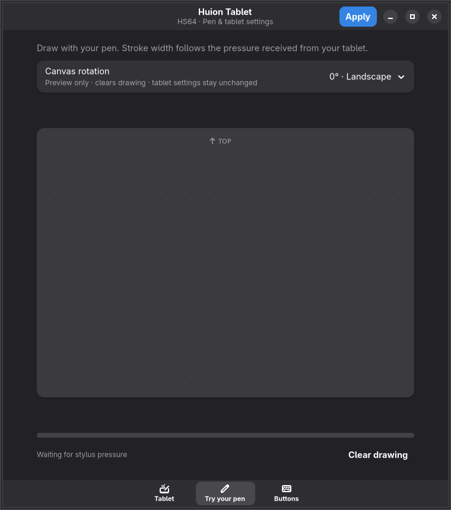
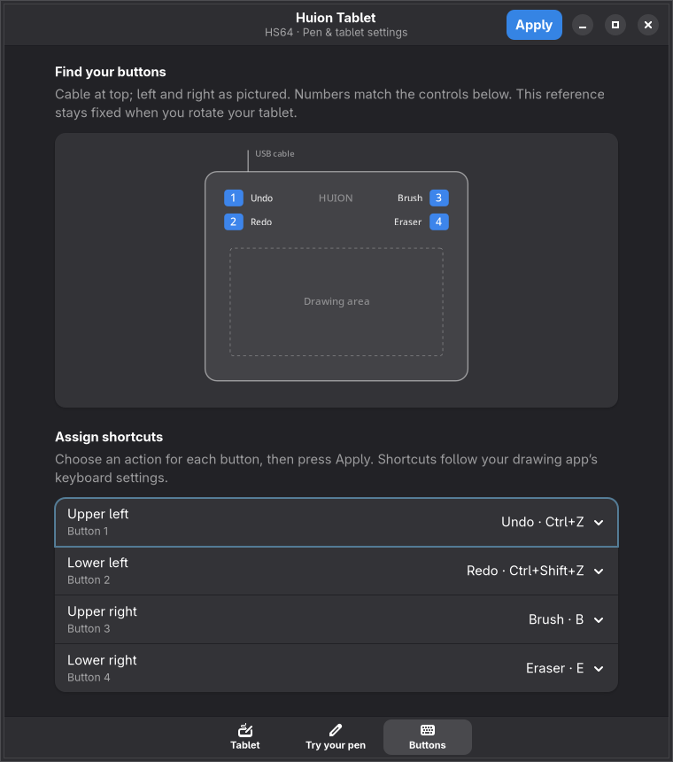

# Kalam

**A reverse engineering project by nirusaki.** A native Wayland driver and settings app for the **Huion HS64**.

## Install

Open a terminal in your Wayland desktop and paste this, **without sudo**:

```sh
curl -fsSL https://raw.githubusercontent.com/Nirusaki-Malaal/HuionHS64-Wayland/main/bootstrap.sh | sh -s -- --enable
```

The installer detects your distro, installs dependencies, builds the app and starts the driver at login. It asks for your password when needed. [Special setups and uninstalling](documentation.md#online-installer).

## What it does and how to use it

- Pen pressure, tablet rotation and four configurable shortcut buttons.
- Open **Kalam Tablet Settings** from your app menu, or run `huion-gui`.
- Choose your settings, press **Apply**, and draw in **Try your pen** to test them.

## Screenshots

<p>  </p>

## Performance

| Component | Memory (PSS) | Idle CPU |
| --- | ---: | ---: |
| Driver | 3.96 MiB | 0.23% |
| Settings window | 201.85 MiB | 0.10% |

30-second observation on Arch Linux/Wayland, with the settings window open. Results vary. [Method and raw measurements](documentation.md#resource-measurements).

## AI usage disclosure

Reverse engineering and development were AI-assisted using **GEMINI 3.8 Flash**, **Muse Spark 1.3**, and **GPT-6.1 Sol Light**.

## License

[GPL-3.0-or-later](LICENSE). Want to know more? Read the [documentation](documentation.md).
